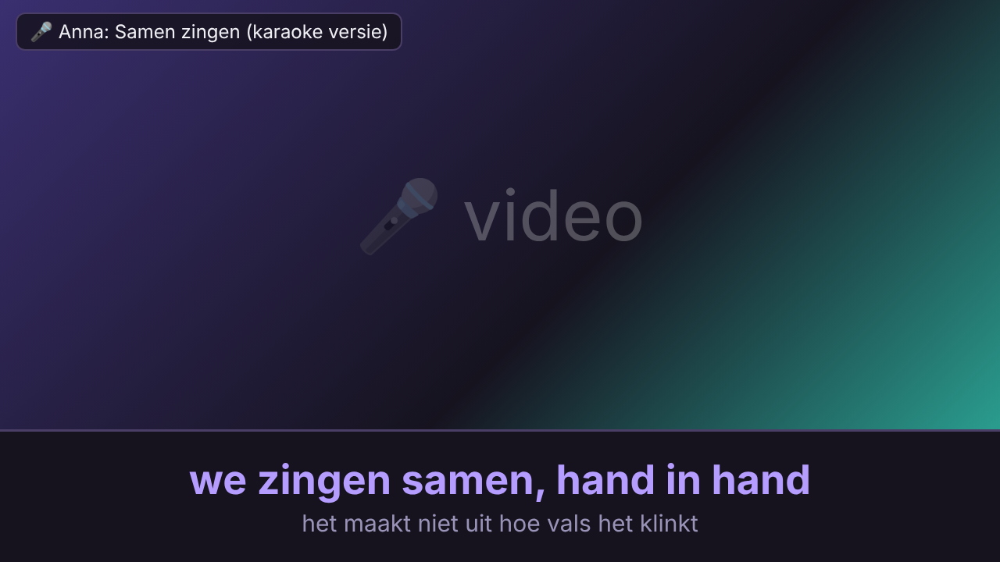
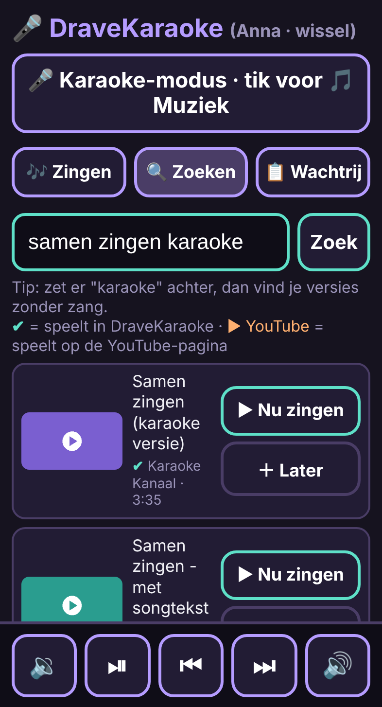
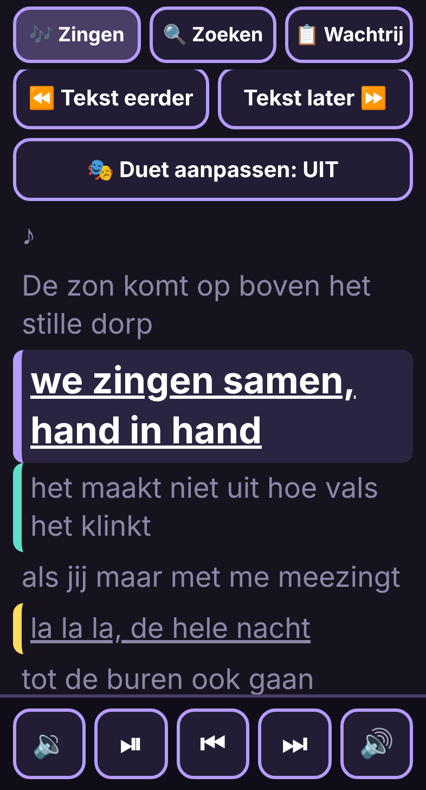
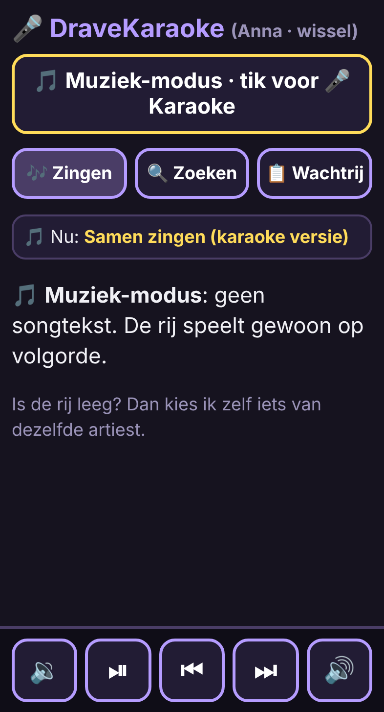

# DraveKaraoke

**Samen zingen met je pc en je mobiel.** De pc speelt het liedje van YouTube via je boxen of soundbar, en op je mobiel loopt de songtekst mee. Gewoon voor de lol: geen score, geen dure karaokemachine. En met de **muziek-modus** bedien je je muziek vanaf de bank.

## 🎬 Uitlegvideo

[▶ Bekijk de uitlegvideo](https://dravenlock.nl/video/DraveKaraoke.mp4) (Nederlands). Hij zit ook in de download.

## Wat kan het?

- **Zoeken op je mobiel** – typ een liedje of artiest. Een groen ✔ speelt in DraveKaraoke; ▶ YouTube = mag alleen op YouTube zelf, en speelt dan op de YouTube-pagina (de tekst loopt toch mee).
- **▶ Nu zingen** of **＋ Later** – meteen spelen, of achteraan in de wachtrij. De wachtrij gaat **om de beurt**.
- **Meelopende songtekst** – op de pc onderaan het beeld, en op je mobiel met de regel van nu groot. Tekst eerder/later bijstellen, of zelf de tekst zoeken (*Pastorale Ramses Shaffy*). Teksten komen van [LRCLIB](https://lrclib.net) (gratis, zonder account).
- **Duet** – geef elke regel een kleur: zanger 1, zanger 2, of samen. Je eigen regels zijn onderstreept.
- **🎵 Muziek-modus** – geen tekst, de rij speelt gewoon door. Is hij leeg, dan kiest DraveKaraoke zelf iets van dezelfde artiest. Ideaal als de pc in een andere kamer staat.
- **YouTube Premium** – log één keer in (rechts op de pc), dan zing je zonder reclame. Of kies **Speel in mijn browser**.
- **📲 Android-app** – zoekt de pc zelf in je wifi en onthoudt hem. Nooit meer een QR-code scannen.

| Zoeken | Zingen (duet) | Muziek-modus |
|---|---|---|
|  |  |  |

## 🔒 Alles blijft thuis

DraveKaraoke draait een klein webservertje op je eigen pc. Je mobiel praat er via je **eigen wifi** mee. Er is geen account en geen cloud van ons. Je namen, instellingen en je YouTube-inlog staan in de map van de app.

*Versie 0.2 (Android-app 0.2.1)*

## ⬇️ Downloaden (Windows, geen Python nodig)

### [👉 Download DraveKaraoke 0.2](https://github.com/mbrv4ever/DraveKaraoke/releases/latest)

1. Download het **.zip**-bestand en pak het uit (rechtsklik → **Alles uitpakken...**).
2. Dubbelklik op **DraveKaraoke.exe**. Vraagt Windows of het netwerk mag? Kies **Toestaan** (Privé-netwerken).
3. Scan de QR-code rechts met je mobiel (zelfde wifi). Daarna kun je bij **Wachtrij** de Android-app downloaden. De `.apk` staat ook los bij de release.
4. Lees eerst **Lees_mij_eerst.pdf**. Er zit ook een snelgids met plaatjes bij.

> Zie je een blauw scherm "Windows heeft uw pc beschermd"? Klik op **Meer informatie** → **Toch uitvoeren**.

## Vanaf de broncode

Installeer Python 3.10 – 3.12 en de pakketten uit `requirements.txt`, en start `main.py`. `Start-DraveKaraoke.bat` doet dit voor je; `Build-DraveKaraoke-EXE.bat` maakt de .exe.

- `karaoke.py` – wachtrij (om de beurt), songteksten, duet, muziek-modus
- `server.py` – het webservertje (poort 8765) voor de mobieltjes
- `main.py` – het pc-venster (PyQt6 + QtWebEngine)
- `web/` – de mobiele pagina en de speler
- `android/` – de Android-app (Java, WebView). Bouwen met `gradle assembleRelease`; zonder eigen sleutel in `android/sleutel/` krijg je een ongetekende apk.

## Licentie

Vrije software onder de **GNU GPL v3.0** (zie [LICENSE](LICENSE)). Gemaakt door **Dravenlock** (Roger & Claudio). Gratis; donaties welkom, nooit verplicht: [paypal.me/roger076](https://paypal.me/roger076). Vragen: service@dravenlock.nl
